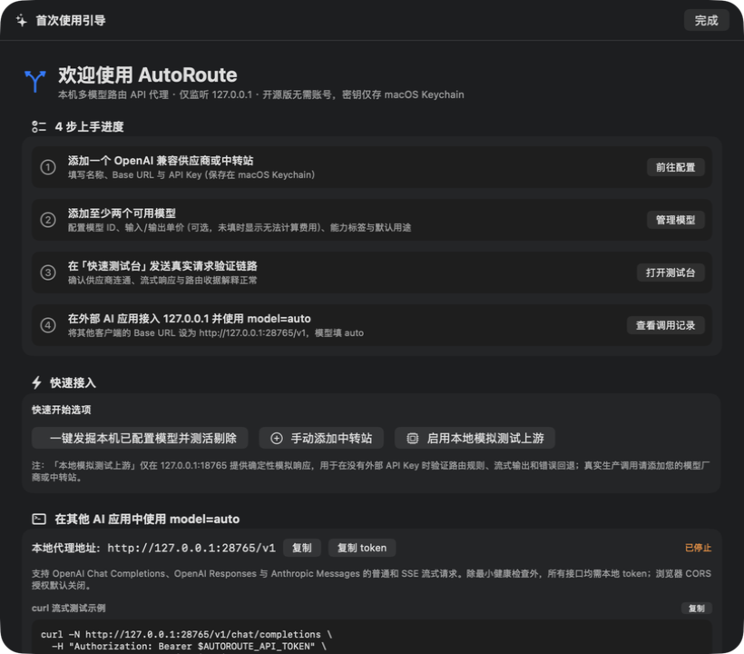
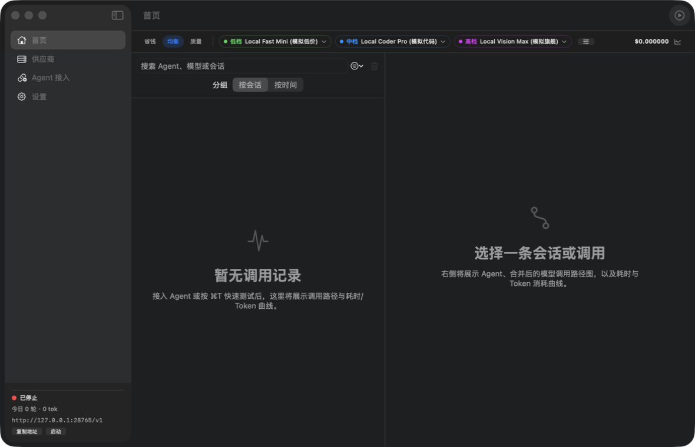
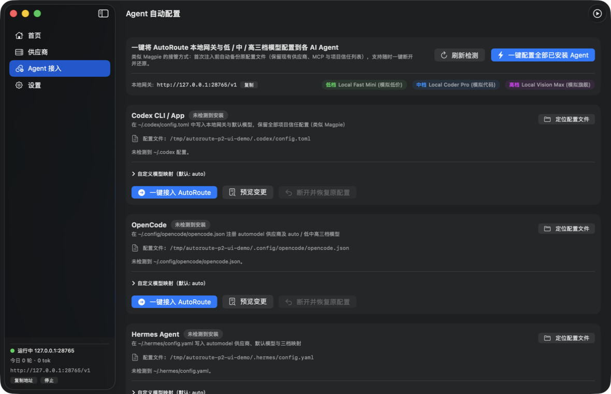
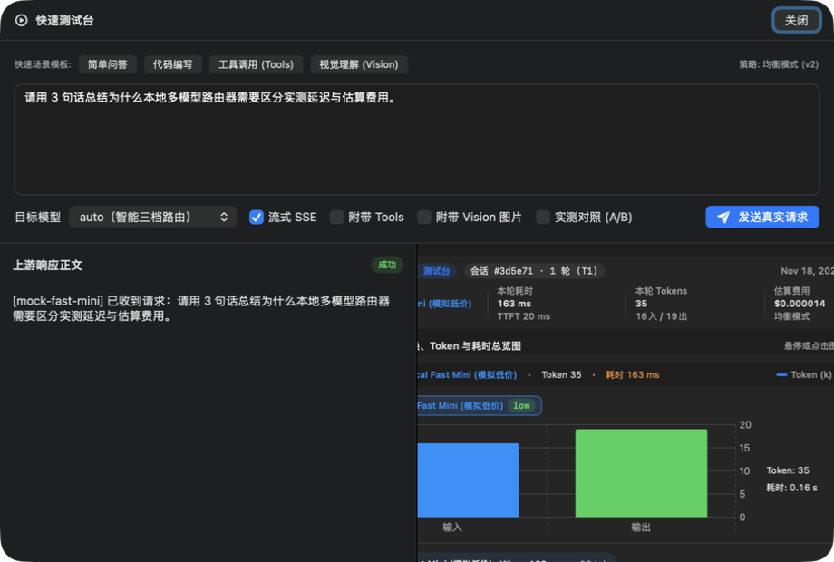
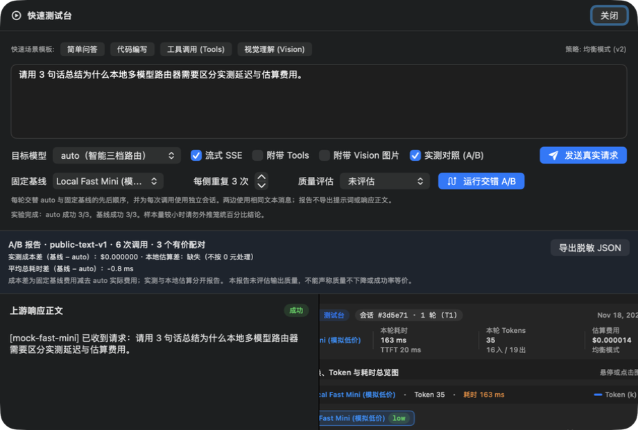

# AutoRoute

[简体中文](README.zh-CN.md) · [MIT License](LICENSE) · [Contributing](CONTRIBUTING.md) · [Security](SECURITY.md)

AutoRoute is an open-source, native macOS router for multiple model providers. It exposes a local `127.0.0.1` API to your coding agents, chooses a model according to your policy and request capabilities, forwards the request to your configured upstream, and keeps an inspectable local routing receipt.

There is no hosted control plane, account requirement, or mandatory telemetry. You supply the upstream providers and credentials.

## Why AutoRoute?

- **One local endpoint, three tiers:** use `auto`, `auto/low`, `auto/medium`, or `auto/high` instead of rewiring every client.
- **Deterministic constraints first:** tools, vision, context size, price caps, health, cooldowns, ordered fallbacks, and session stickiness are evaluated locally.
- **Evidence instead of marketing:** receipts separate routing time, TTFT, total latency, upstream-reported usage, local estimates, retries, and missing prices.
- **Agent-aware without losing compatibility:** stable identities such as `auto/agent/codex` support per-Agent policy and budgets while legacy `auto` configurations continue to work.

Balanced `auto` starts with the low tier for retrieval, extraction, or summaries, the middle tier for everyday questions and scoped work, and the high tier for architecture and difficult debugging. With session phase switching enabled, a new user turn can change tiers while tool continuations keep their model when it remains eligible. Explicit reasoning effort stays in effect independently of the tier. When a required tool call is missing, retrying the same request can raise effort first, then move up a tier when the request can safely switch.

## 60-second demo

The scripted walkthrough covers **discover → connect → request → receipt → fallback**, plus an optional repeatable A/B run. It uses the built-in loopback mock for an offline demonstration and labels it as such.

[Open the 60-second demo and recording script](docs/demo/60-second-demo.md). No prerecorded video or official benchmark is claimed; run the steps locally to produce real evidence.

The following screenshots come from the real app UI running with an isolated temporary configuration and only the built-in loopback mock. They demonstrate navigation and receipt formats, not real-provider performance or savings.





## Supported agents and protocols

One-click backup/connect/restore is available for Codex, Claude Code, OpenCode, Hermes, and Shell/Continue. Guides:

- [Codex](docs/integrations/codex.md)
- [Claude Code](docs/integrations/claude-code.md)
- [OpenCode](docs/integrations/opencode.md)



Local endpoints:

| Endpoint | Compatibility |
| --- | --- |
| `POST /v1/chat/completions` | OpenAI Chat Completions, JSON and SSE |
| `POST /v1/responses` | OpenAI Responses, JSON and SSE, including native Responses routing where required |
| `POST /v1/messages` | Anthropic Messages, JSON and SSE |
| `GET /v1/models` | Legacy tiers, stable Agent aliases, and enabled concrete models |
| `GET /health`, `GET /v1/health` | Minimal anonymous health response |

Text, tool calls, vision messages, reasoning content, and usage extraction are supported within the documented adapter limits. Embeddings, image generation, audio, and `n > 1` are not implemented; unsupported requests receive an explicit error rather than silent degradation.

For stateful Responses requests, send `store: true` on the first call to select a native OpenAI Responses upstream that supports storage. AutoRoute keeps continuation ownership in memory and forwards known state references only to the original model, upstream, and credential. If automatic routing cannot verify the origin after a restart or expiration, resend the replayable conversation without the state reference.

## Install

Requirements: macOS 14+, Swift 5.10+ or Xcode Command Line Tools. The verified development environment is Apple Silicon with Swift 6.2.3.

```bash
git clone <your-authorized-repository-url> autoroute
cd autoroute
swift test
bash macos/build_app.sh
open dist/AutoRoute.app
```

`macos/build_app.sh` creates `dist/AutoRoute.app`. Without `DEVELOPER_ID_APPLICATION`, it uses an **ad-hoc signature for local development only**. See the [release checklist](docs/release/RELEASE_CHECKLIST.md) for Developer ID signing, notarization, ZIP/SHA-256, and Homebrew cask generation. A public Release or Homebrew installation is not implied by this source tree.

## 5-minute Quickstart

1. **Connect a provider.** Add a provider and a compatible model, or explicitly discover local configuration. Discovery reads supported Agent configuration and probes enabled upstreams, which may incur charges. Newly discovered providers are disabled until you enable them. Keys are stored in macOS Keychain.
2. **Preview and connect one Agent.** Review the managed settings, then confirm backup and write. Balanced routing and automatic tier assignments are the defaults; an existing backup can be restored.
3. **Send the first request from that Agent.** Restart the Agent and make a normal request; the app distinguishes configuration written from a verified real Agent request. The standalone HTTP self-test, manual curl setup, policy settings and mock demo remain under advanced options.

To use WorkBuddy as an upstream provider, select the preset for your region, save your API key, and test the connection to import the models available to your account. [WorkBuddy API keys](https://www.workbuddy.cn/profile/keys) · [WorkBuddy AI API keys](https://www.workbuddy.ai/profile/keys)

```bash
export AUTOROUTE_BASE_URL='http://127.0.0.1:8765/v1'
export AUTOROUTE_API_TOKEN='paste-the-token-copied-from-AutoRoute-Settings'
curl -N "$AUTOROUTE_BASE_URL/chat/completions" \
  -H "Authorization: Bearer $AUTOROUTE_API_TOKEN" \
  -H "Content-Type: application/json" \
  -d '{
    "model": "auto",
    "stream": true,
    "messages": [{"role": "user", "content": "Explain Raft consensus in three sentences."}]
  }'
```

All endpoints except minimal health checks require the real local token via `Authorization: Bearer` or `x-api-key`. Arbitrary placeholders from older builds are not accepted.

## Security and privacy

- The server binds only to `127.0.0.1`, validates Host and Origin, compares tokens in constant time, and does not grant wildcard CORS.
- Provider keys and the local API token use separate Keychain entries. Do not commit tokens, configuration exports, private prompts, or unredacted receipts.
- If the local token cannot be persisted, AutoRoute keeps only a per-process random fallback and visibly blocks proxy startup and Agent writes until Keychain persistence is repaired.
- Request/response body recording defaults to **off**. Existing explicit choices are preserved during migration. Derived prompt summaries and persisted upstream error bodies are also removed when body recording is disabled; only a fixed error category and HTTP status remain in history/config.
- Routing receipts, the budget ledger, and minimal onboarding funnel state remain local. Settings can view, confirm-clear, and actively export aggregate metrics with schema and definition versions; failed clears are surfaced and do not claim success.
- Local metrics do not contain prompts, code, responses, tokens, or advertising identifiers and do not start additional network requests. Demo and legacy-unclassified receipts are separated from real-route metrics.
- Monthly global and per-Agent budgets use a durable local ledger independent of the capped UI history, so older spending still enforces the hard limit. Explicit demo receipts never count toward budgets. The settings warning threshold is non-blocking; only the hard limit rejects requests before upstream execution. In-flight work, delayed usage, and price changes can still overspend; always reconcile with provider billing.

See [SECURITY.md](SECURITY.md) for reporting and [docs/development/P0-P2-DEVELOPMENT.md](docs/development/P0-P2-DEVELOPMENT.md) for the acceptance contract.

## Repeatable A/B and cost accounting

The Test Bench uses only the auditable interleaved A/B runner to alternate `auto` and a fixed baseline over independent sessions. Normal one-off requests never call a hidden baseline. Each side creates a CallRecord and passes through budget, usage, and retry accounting; the report stores sample/policy/Agent metadata, non-sensitive request parameters, model IDs, timestamps, retries, routing/TTFT/total latency, usage source, and cost status—not prompts or response bodies.

Measured and estimated differences are reported separately per attempt, so an estimated retry cannot be counted as measured cost. Real A/B cost metrics accept only pairs where both sides use upstream-reported usage without estimated retries. Missing usage or prices stay missing. “Not assessed” quality means the report cannot claim equivalent quality. A real-upstream report must be generated by the user; the repository contains no fabricated official score.





## Build, test, and contribute

```bash
swift test
bash macos/build_app.sh
git diff --check
codesign --verify --deep --strict dist/AutoRoute.app
bash macos/package_app.sh
```

CI runs the complete test suite without filtering out security, migration, budget, A/B, or metrics tests. See [CONTRIBUTING.md](CONTRIBUTING.md), [ROADMAP.md](ROADMAP.md), [CHANGELOG.md](CHANGELOG.md), and [Good First Issue candidates](docs/community/GOOD_FIRST_ISSUES.md).

## License

AutoRoute is available under the [MIT License](LICENSE). Internal target names `AutoModel` and bundle identifier `org.automodel.app` remain for upgrade compatibility; the user-visible app is AutoRoute.
